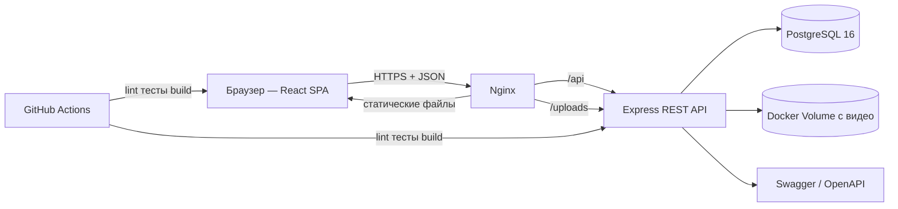
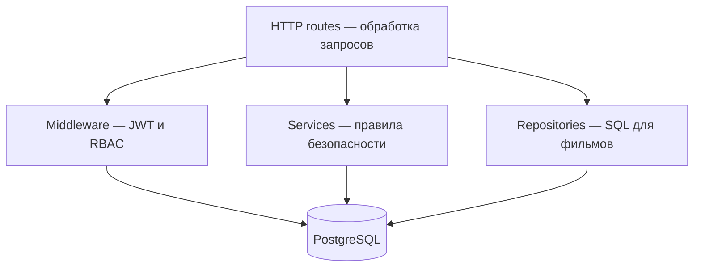
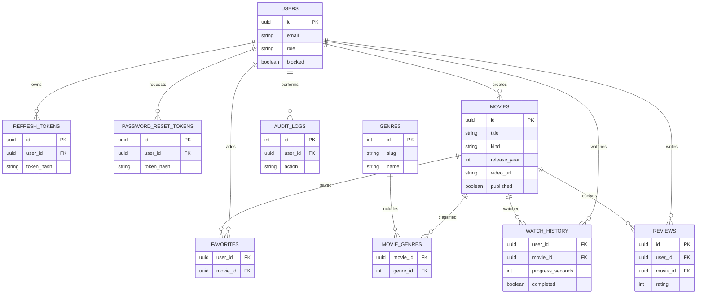

# Архитектура и ER-модель Ciko

## Общая архитектура

В среде Docker Compose поднимаются `db`, `api`, `web`. Контейнер `web` компилирует React/Vite в HTML/CSS/JS, Nginx раздаёт файлы и проксирует `/api` и `/uploads`; API хранит файлы в отдельном volume и обращается к PostgreSQL.

## Слои backend

Контроллеры/маршруты отвечают за HTTP, сервисы — за проверку токенов и правил, репозитории — за выборку и сохранение данных. Часть небольших запросов профиля и админки пока расположена в соответствующих маршрутах — дальнейшая нормализация проекта возможна перед защитой.

## ER-диаграмма, 10 основных сущностей

Нормализация: жанры вынесены отдельно, связь много-ко-многим — в `movie_genres`; избранное/история/отзывы связывают пользователей и фильмы отдельными сущностями. В таблицах нет повторяющихся списков жанров. Поиск по имени фильма индексирован выражением `LOWER(title)`, годы и даты — отдельными индексами.

## Безопасность

- bcrypt для паролей; refresh-токены хранятся в виде SHA-256, не в исходном виде.
- RBAC проверяется middleware на сервере; роль читается заново из БД при каждом защищённом запросе.
- Параметризованные SQL-запросы против SQL-инъекций.
- JSON-валидация через Zod, ограничения на MIME-типы и размеры файлов.
- CORS на список адресов; ответы API имеют единый формат `success/data` или `success/error`.
- На публичном сервере дополнительно обязательны HTTPS, безопасные секреты, отключение демо-пользователей, резервные копии и лимиты запросов.

## Нефункциональные требования

Frontend рассчитан на ширину от 320 до 1920 px через адаптивные сетки и медиазапросы. Время API менее 500 мс и точное покрытие тестами **пока не измерены**. Эти показатели необходимо зафиксировать после запуска на тестовой базе и приложить скриншоты/логи.

## Расширение: комнаты

Миграция `002_rooms.sql` добавляет таблицы `rooms`, `room_members`, `room_messages`. Пользователь создаёт комнату через `POST /api/rooms`, второй пользователь входит по коду через `POST /api/rooms/join`. Все действия с комнатой проверяют членство в `room_members`. Состояние просмотра обновляет только создатель через `PUT /api/rooms/:id/state`. У гостей каждые 2,5 секунды сверяется положение прямого видео с сервером. Чат также доступен только участникам. YouTube/Vimeo остаются без общей синхронизации.
